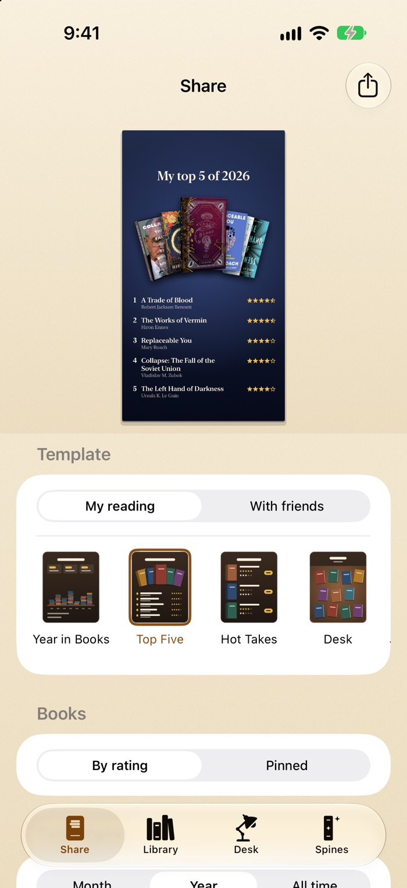
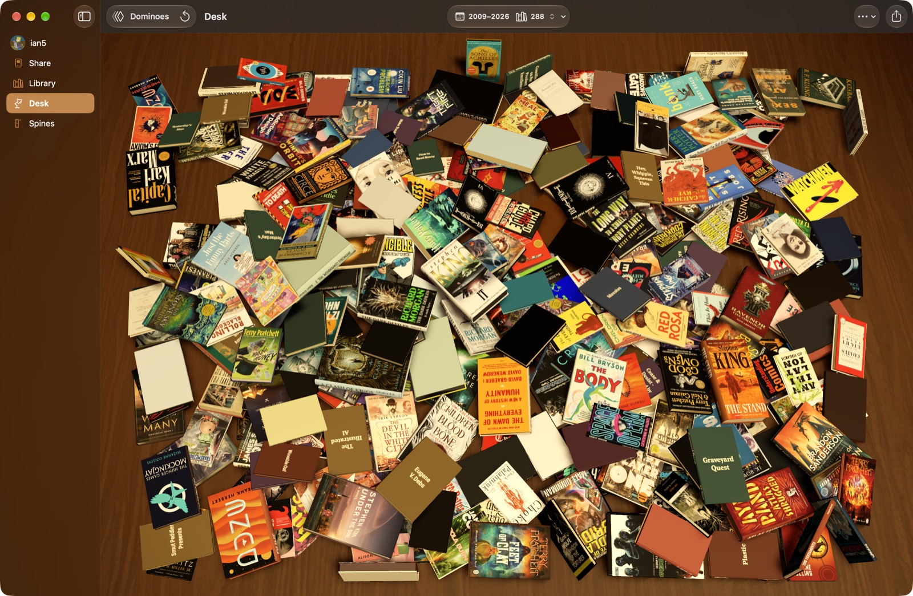
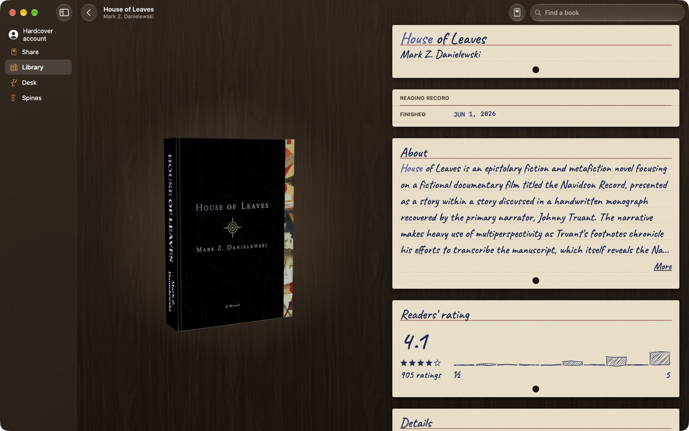

# Bookworms for iOS and macOS

  

Bookworms is delightful app for sharing your reading activity and making your ebook library feel _real_. 

Bookworms loads your library from Hardcover, and can display your library in 3D. 

* Browse your recent reads in 2D or 3D, vertically or horizontally in a skeuomorphic bookcase or stack view
* Select a book to see details on a card from the card catalouge; other details are notecards like you'd see in a bookstore. You can also change the cover art, customize the colors and font, and regenerate the spine design.
    * AI is only used to select colors, fonts, and layout options; generative AI imagery is not used. Custom models (you bring the keys) are supported.
* Choose from nine different sharing types to show off the books oyu loved, the books everyone loved but you hated, and more
* Set up your reads from the year on a desk like dominos, watch them fall, then watch them magically fly into a spread for you to share on socials 
* Your customizations sync with iCloud so you can view your library on [Apple TV](https://apps.apple.com/us/app/bookworms-ebook-display/id6813137450), Mac, and iPhone.

## Screenshots

Share and Library stack on iPhone

 

Desk on Mac, all time

Book details on Mac

